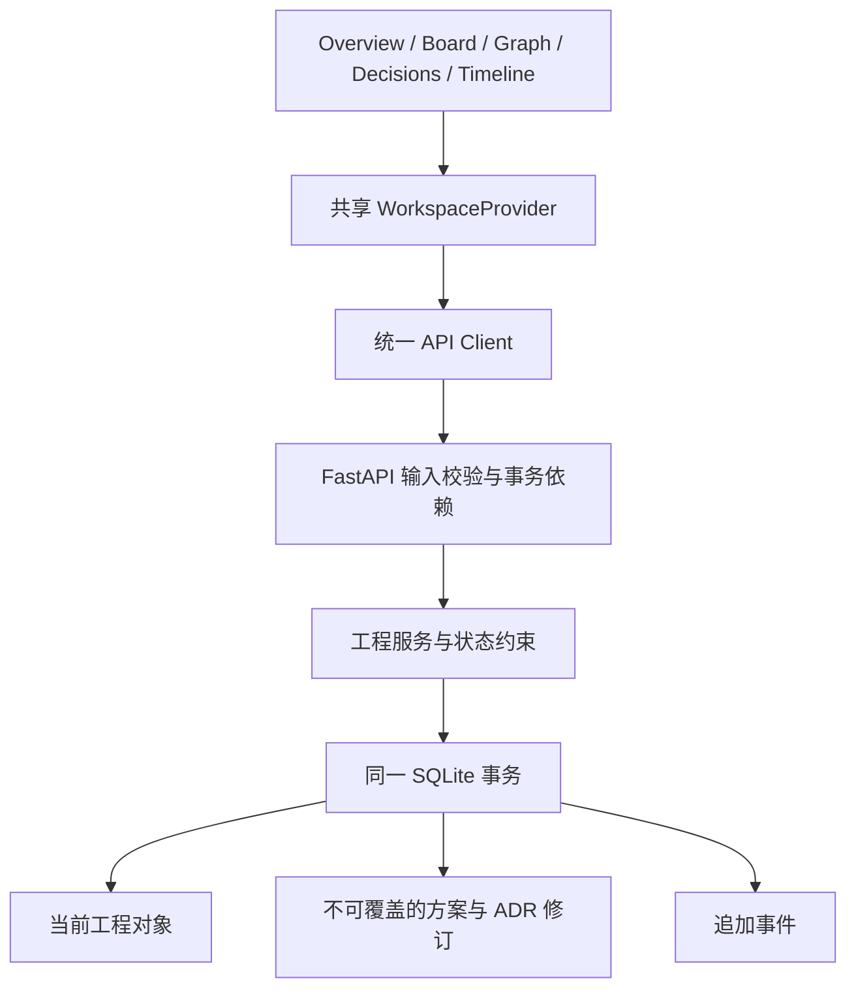

# 系统架构

P0 是完整单机应用：React 工作台展示和编辑结构化对象，FastAPI 负责校验与业务服务，SQLite 是当前状态和历史的唯一事实来源。聊天内容不是数据库输入。

## 运行模式

- 开发：Vite 5173 代理 `/api` 到 FastAPI 8000，两个进程由启动脚本管理。
- 发布：`npm run build` 生成 dist；FastAPI 直接提供该前端、字体和 API，一个进程即可运行。没有公网部署要求。
- 全部代码使用 CPU。前端与 API 无模型调用、CUDA 或 GPU 依赖。

`app.main.create_app` 支持指定测试数据库并在 lifespan 执行 Alembic。默认数据库路径根据源码目录定位，不依赖启动时工作目录。REST 路由都使用统一事务依赖 `get_db`。

## 写入闭环

Pydantic 拒绝未知字段、空标题、无效状态和非法长度。服务验证引用存在于同工程、所有权、状态转换与任务依赖环。当前状态与 Event 在同一 Session／事务内写入；异常导致整个事务回滚。Event payload 保存 before／after 或修订内容，已删除实体的事件仍可解释。

SQLite 使用外键、WAL、30 秒锁等待和 `BEGIN IMMEDIATE`。P0 串行化所有短事务，包括读取，以防两个请求争抢方案版本号或重复 Seed。方案和 ADR 新修订额外要求 expected_version，过期写入返回 409。普通 CRUD 未实现乐观锁；多人编辑与高并发不在本轮范围。

Event、ProposalRevision、DecisionRevision 没有更新／删除 API，数据库触发器进一步拒绝 UPDATE／DELETE。实体依赖由 RESTRICT 外键保护，EntityLink 用服务和触发器验证多态端点与删除安全。

## 前端共享数据

所有页使用同一个 WorkspaceProvider，调用统一 Client。Provider 从选中工程的 API 读取对象、统计、图谱和事件；写入成功后统一重新加载。localStorage 只保存最近选择的工程 ID，不保存工程事实。请求代次防止快速切换工程时旧响应覆盖新工程。

Overview 统计来自后端数据库。Board 显示相同实体并提供合法状态选择。Graph 的节点与边来自后端 graph 接口和真实外键；拖动只调整当前图布局。Timeline 直接分页读取不可变 Event；点击可查看实体或历史快照。

方案历史读取独立 revision 接口，正文以文本显示，不执行用户 HTML。相邻版本用逐行最长公共子序列比较；超过 1000 行时避免高成本计算，展示双列全文。ADR 每次修改保存完整快照、版本号、修改原因和事件。

## 初始化

`seed_demo.py` 在一个事务中创建 MiniLab。`demo_key=minilab-p0` 唯一，检查已存在时返回原工程 ID，不重复插入、也不重置用户修改。9 个功能、3 个里程碑和示例任务均 planned；Demo ADR 是 proposed，未虚构业务完成或测试结果。

## P1 扩展接口

| 现有边界 | 建议下一步 |
|---|---|
| `services/engineering.py` 的业务写入入口 | 在同样约束和事务下提供 Agent 工具适配，避免直接写数据库 |
| `events.emit` 与 actor_type | 引入 Agent／审批者身份和执行关联 ID，保持事件追加 |
| ProposalRevision / DecisionRevision | 添加代码修改、Run、Test Evidence 引用，并保留版本冲突检测 |
| 当前 Feature / Task 状态 | 新建证据与审批实体后实现 verified／accepted，不根据实现状态推断 |
| EntityLink / graph | 扩展允许关系白名单，迁移同步数据库触发器，增加布局与视图保存 |
| Alembic | 每次模型变化添加显式迁移；不修改已经交付的迁移快照 |

这些是扩展边界，不是已实现的 Agent、执行器或测试验收引擎。P0 未接入真实仓库、Git Worktree、任务调度、模型、实验或多用户系统。
