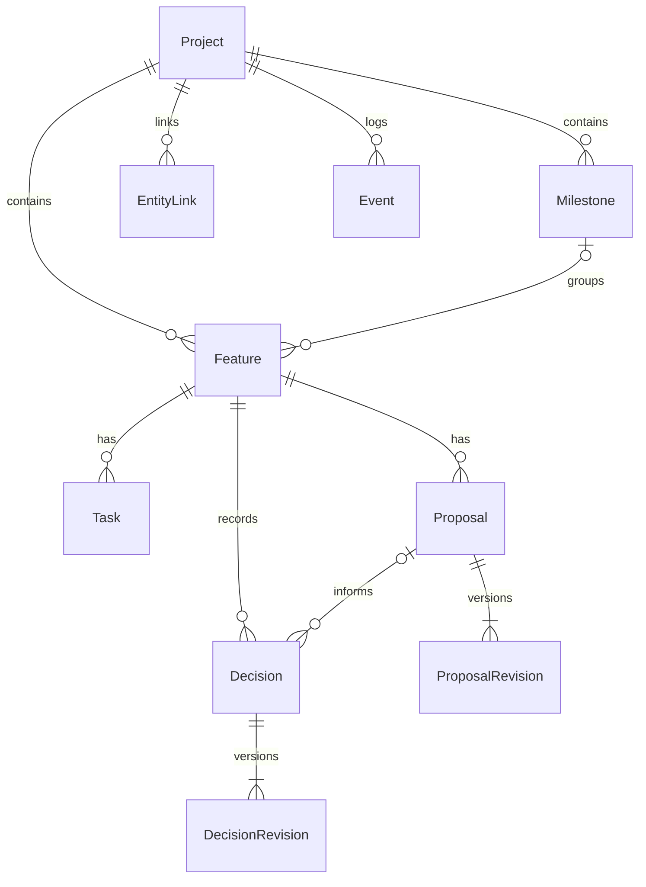

# 数据模型与约束

所有 ID 为 UUID 字符串，时间由 timezone-aware UTC 生成，SQLite 中存 UTC，API 返回带 `Z` 的 ISO 时间。Feature 额外有工程内唯一的 code，例如 F01；UUID 才是 API 引用 ID。

| 实体／表 | 主要字段 | 约束与用途 |
|---|---|---|
| Project / projects | id, name, description, created_at, updated_at, archived, demo_key | 工程归档后只读；唯一 demo_key 保障 Seed 幂等 |
| Milestone / milestones | id, project_id, title, description, order, status, timestamps | 阶段排序非负；删除时不得仍有 Feature |
| Feature / features | id, project_id, milestone_id?, code, title, description, status, timestamps | 工程内 code 唯一；里程碑必须在同工程 |
| Task / tasks | id, project_id, feature_id, title, description, status, timestamps | feature_id 与 project_id 组成作用域外键 |
| Proposal / proposals | id, project_id, feature_id, title, status, timestamps | 正文位于 Revision；归档保留全部版本 |
| ProposalRevision / proposal_revisions | id, proposal_id, version, content, change_reason, created_at | proposal_id + version 唯一，version > 0；不可更新或删除 |
| Decision / decisions | id, project_id, feature_id, proposal_id?, title, context, alternatives, selected_option, rationale, status, version, timestamps | 保存当前 ADR；所选 Proposal 必须同功能、同工程 |
| DecisionRevision / decision_revisions | id, decision_id, version, snapshot, change_reason, created_at | 每次 ADR 写入保存完整快照；版本唯一，不可更新或删除 |
| EntityLink / entity_links | id, project_id, source_type/id, target_type/id, relation_type, created_at | 端点有效、同工程、关系白名单；组合唯一，拒绝自关联和依赖环 |
| Event / events | id, project_id, entity_type/id, event_type, actor_type, occurred_at, payload | 追加；不提供普通更新／删除；保留删除前快照 |

## 对象关系

Feature 可不分配 Milestone；Task、Proposal、Decision 必须属于一个 Feature。Decision 的 proposal_id 可为空。修改 ADR 不允许改变其 feature_id 或 proposal_id：改变决策所有权时应创建新 ADR，并按需取代旧 ADR。

## 允许的显式关联

| 源 | 目标 | relation_type | 额外条件 |
|---|---|---|---|
| Feature | Task | has_task | Task 的真实 feature_id 等于源 Feature |
| Feature | Proposal | has_proposal | Proposal 的真实 feature_id 等于源 Feature |
| Feature | Decision | has_decision | Decision 的真实 feature_id 等于源 Feature |
| Proposal | Decision | informs | 同功能；可记录支撑该 ADR 的方案 |
| Task | Task | depends_on | 同工程、不同对象、不得形成环 |

图谱同时读取外键关系和 EntityLink，并对相同 source/target/relation 去重。depends_on 的方向是“源任务依赖目标任务”。显式所有权关系不是改动真实归属的替代接口；移动任务前须移除其 has_task 关联。

## 状态转换

创建 Milestone、Feature、Task 时只允许 planned。保持原状态的有效编辑允许；无实际变化的普通 PATCH 不追加虚假变更事件。

| 对象当前状态 | 允许的下一状态 |
|---|---|
| Task planned | in_progress, blocked |
| Task in_progress | planned, blocked, implemented |
| Task blocked | planned, in_progress |
| Task implemented | in_progress（重新开发） |
| Feature / Milestone planned | in_progress, blocked |
| Feature / Milestone in_progress | planned, blocked, implementation_complete |
| Feature / Milestone blocked | planned, in_progress |
| Feature / Milestone implementation_complete | in_progress |
| Proposal draft | candidate, archived |
| Proposal candidate | draft, selected, archived |
| Proposal selected | candidate, archived |
| Proposal archived | draft（恢复方案） |
| Decision proposed | accepted, rejected, superseded |
| Decision accepted | superseded；也可保留 accepted 并新增内容修订 |
| Decision rejected | proposed, superseded |
| Decision superseded | 只读 |

新 Proposal 可为 draft 或 candidate。新 ADR 可为 proposed 或 accepted；确认时必须有 selected_option 与 rationale。所有 ADR 更改都经独立修订接口并提供 expected_version、change_reason。

Task implemented 不会自动更新 Feature，不会产生测试或验收结论。当前模型没有功能 verified／accepted，也没有 Test Evidence。ADR accepted 的含义只是技术选择确认，与功能验收无关。

## 删除与历史保留

- 工程 DELETE 是归档，连同全部状态和历史保留，普通列表默认隐藏。
- 方案 DELETE 是归档，不删除 Revision；恢复需将状态设为 draft。
- ADR DELETE 返回 409；通过新修订标记 superseded。
- 任务、功能、里程碑删除前检查外键依赖和显式关联。违反约束返回 409，无悬空引用。
- EntityLink 可删除，删除行为会追加 link.deleted 事件。
- Event 的 entity_id 是历史引用，刻意不对可删除实体建立外键；payload 保留事件发生时的快照。历史事件指向已删除对象不属于当前图谱中的悬空关联。

## 数据库防线

作用域复合外键阻止跨工程 Milestone/Feature/Task/Proposal/Decision 关联。`0002` 触发器阻止历史表 UPDATE/DELETE，验证 EntityLink 类型、端点、同工程、所有权，并阻止删除仍被显式链接的实体。依赖环检测在服务层执行。

业务状态转换、变更原因与追加事件由服务层保障；直接绕过应用写 SQL 不是支持的使用方式。数据库约束也不能代替完整的业务服务。
